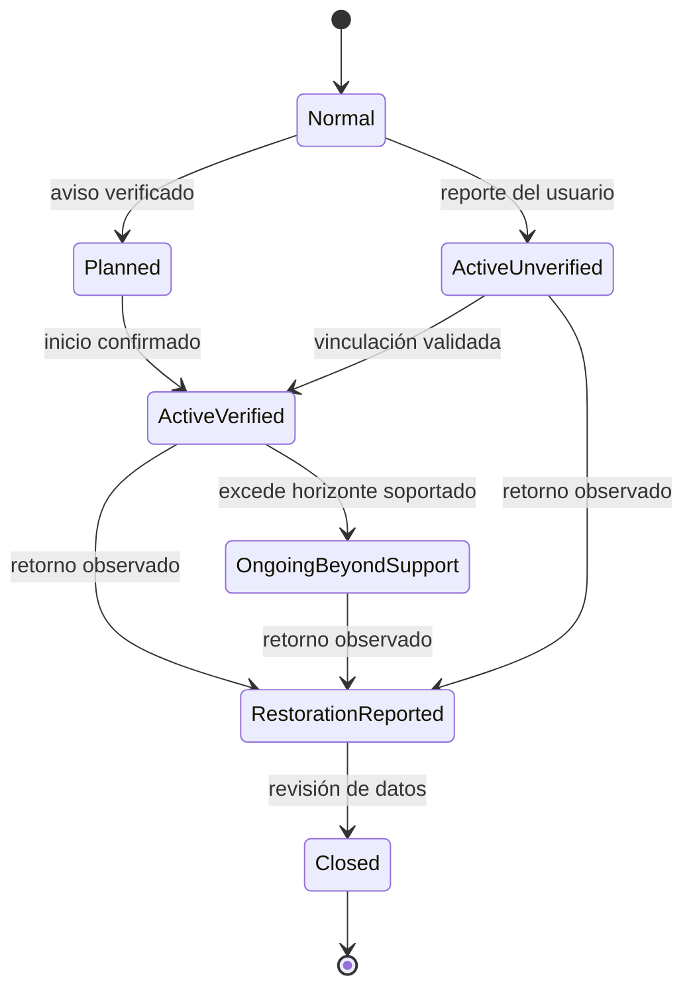
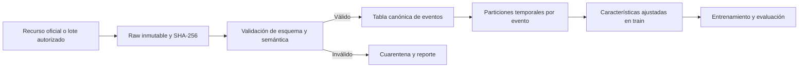
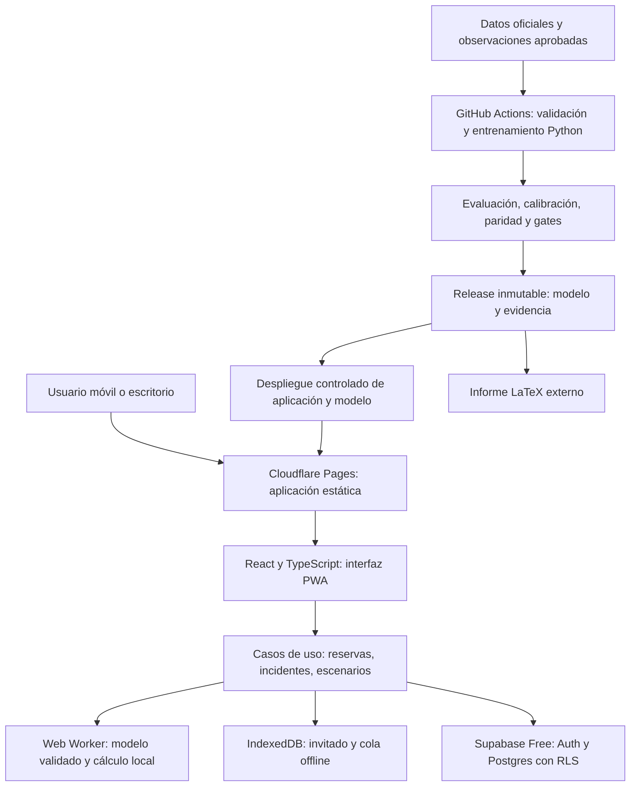
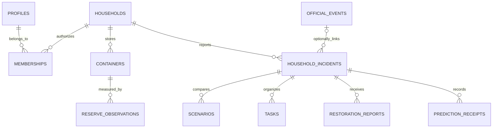
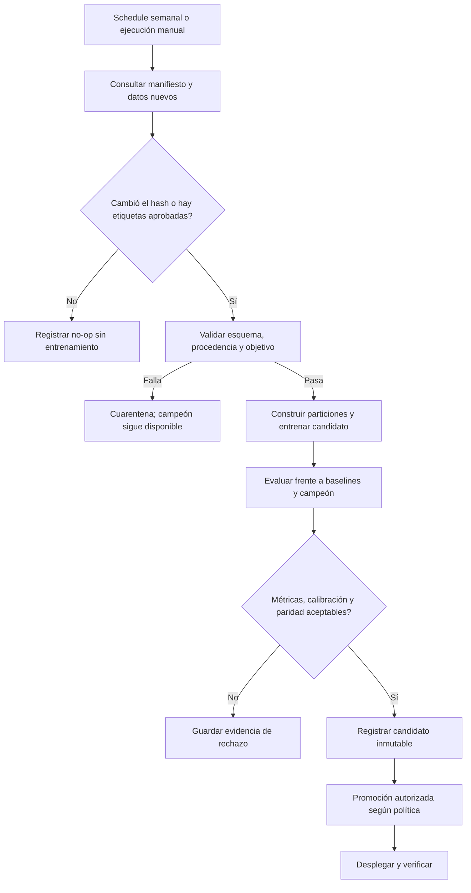

# Asu — Plan integral de implementación

**Producto:** asistente de continuidad de agua para hogares del Perú, con extensión a pequeños hospedajes.<br>
**Estado de este documento:** especificación de implementación; no certifica una aplicación entrenada, desplegada o validada en producción.<br>
**Repositorio:** <https://github.com/ForLess01/asu> — privado al inicio.<br>
**Informe académico:** fuera del repositorio, en `../informes/asu/` respecto a su raíz.<br>
**Base documental consultada:** 20 de octubre de 2026. Precios y cuotas deben reconfirmarse antes de activar servicios.

> **Actualización de implementación — 21/10/2026:** por decisión aprobada, Neon Free sustituye a Supabase como proveedor activo de cuentas y sincronización. Neon Auth, Data API, migración y pruebas reales entre cuentas/dispositivos ya tienen evidencia; consultar `docs/NEON.md` y `docs/DELIVERY_STATUS.md`. Las referencias a Supabase en el diseño original quedan como antecedentes, no como configuración actual. El propietario habilitó los jobs de GitHub; la publicación se realiza desde el repositorio remoto, después de CI aprobado, sin build local. El recibo de despliegue determina si la web ya fue verificada. No cambió el carácter experimental del objetivo de ML.

## Lectura ejecutiva

Asu debe responder una pregunta práctica: **«Durante este corte, ¿cuánto podría durar mi reserva y cómo puedo organizarme?»** La experiencia combina información de interrupciones, estimaciones supervisadas con incertidumbre, un balance explícito de agua y acciones compartidas.

La implementación tiene tres condiciones de salida:

1. **Validez del objetivo:** confirmar qué campos de SUNASS representan restablecimiento real, previsto y reportado. No confundirlos.
2. **Calidad predictiva:** demostrar ventaja frente a referencias simples en datos temporales independientes y medir la calidad de los intervalos.
3. **Producto operativo:** publicar una aplicación utilizable, con persistencia, pruebas, actualización controlada del modelo y evidencia de recuperación ante fallos.

La arquitectura propuesta evita un servidor Python de inferencia permanentemente encendido: **Python entrena en GitHub Actions; un modelo compacto y verificable se ejecuta en un Web Worker del navegador; Cloudflare Pages sirve la aplicación; Supabase Free ofrece cuentas y sincronización.** La exportación del modelo requiere una prueba de equivalencia antes de convertirse en una decisión irreversible.

**Alcance de la edición inicial del plan:** planificación, identidad gráfica y preparación del repositorio. El estado ejecutado posterior se registra en `docs/DELIVERY_STATUS.md`; esta especificación no constituye por sí sola una prueba de implementación, despliegue o validez científica.

## Índice

1. [Objetivos y evaluación académica](#1-objetivos-y-evaluación-académica)
2. [Alcance de producto](#2-alcance-de-producto)
3. [Flujos completos y estados](#3-flujos-completos-y-estados)
4. [UX/UI e identidad](#4-uxui-e-identidad)
5. [Datos y contrato del objetivo](#5-datos-y-contrato-del-objetivo)
6. [Preparación y análisis exploratorio](#6-preparación-y-análisis-exploratorio)
7. [Formulación del aprendizaje supervisado](#7-formulación-del-aprendizaje-supervisado)
8. [Experimentos y selección de modelos](#8-experimentos-y-selección-de-modelos)
9. [Incertidumbre y decisiones](#9-incertidumbre-y-decisiones)
10. [Exportación e inferencia en el navegador](#10-exportación-e-inferencia-en-el-navegador)
11. [Simulador de reservas](#11-simulador-de-reservas)
12. [Arquitectura y responsabilidades](#12-arquitectura-y-responsabilidades)
13. [Persistencia y contratos](#13-persistencia-y-contratos)
14. [GitHub y organización del código](#14-github-y-organización-del-código)
15. [Integración y entrega continuas](#15-integración-y-entrega-continuas)
16. [Reentrenamiento y registro de modelos](#16-reentrenamiento-y-registro-de-modelos)
17. [Despliegue gratuito y presupuesto](#17-despliegue-gratuito-y-presupuesto)
18. [Monitoreo y recuperación](#18-monitoreo-y-recuperación)
19. [Pruebas y criterios de aceptación](#19-pruebas-y-criterios-de-aceptación)
20. [KPIs y medición de utilidad](#20-kpis-y-medición-de-utilidad)
21. [Informe LaTeX externo](#21-informe-latex-externo)
22. [Figuras y tablas obligatorias](#22-figuras-y-tablas-obligatorias)
23. [Fases de ejecución](#23-fases-de-ejecución)
24. [Demostración y entrega](#24-demostración-y-entrega)
25. [Riesgos y decisiones pendientes](#25-riesgos-y-decisiones-pendientes)
26. [Fuentes verificadas](#26-fuentes-verificadas)

---

## 1. Objetivos y evaluación académica

### 1.1 Objetivo general

Desarrollar, evaluar y desplegar una aplicación de aprendizaje supervisado que apoye la planificación de reservas durante interrupciones de agua, con un ciclo de vida reproducible de software, datos y modelos.

### 1.2 Objetivos específicos

- Construir una tabla de eventos con procedencia, calidad y disponibilidad temporal verificables.
- Comparar referencias y varias familias de regresión; justificar cada variable y algoritmo.
- Optimizar hiperparámetros sin utilizar el conjunto final de prueba para seleccionarlos.
- Estimar intervalos y comunicar incertidumbre sin crear garantías de restablecimiento.
- Traducir la estimación del evento a escenarios domésticos mediante cálculos transparentes.
- Mantener una experiencia rápida incluso cuando la sincronización remota esté temporalmente indisponible.
- Automatizar comprobaciones, entrenamiento, evaluación, publicación y reversión.
- Entregar un informe reproducible que permita a otro equipo mantener el sistema.

### 1.3 Matriz de trazabilidad con la rúbrica

| Criterio | Puntos | Implementación / evidencia necesaria |
|---|---:|---|
| Funcionamiento de la aplicación | 2 | Flujo completo en inglés: hogar, reserva, incidente, estimación, escenario y cierre. |
| Entrenamiento del modelo | 4 | EDA, variables, particiones, baselines, algoritmos, ajuste, métricas, errores e incertidumbre. |
| Despliegue | 2 | URL pública funcional, versión visible, procedimiento reproducible y pruebas desde un dispositivo externo. |
| Mantenimiento e integración continua | 4 | Workflows ejecutados; actualización válida, rechazo de datos/modelo y rollback demostrables. |
| Informe: herramientas/plataformas | 2 | Versiones, cuentas, cuotas, requisitos y decisiones justificadas. |
| Informe: organización del código | 2 | Diagrama de módulos, árbol del repositorio y responsabilidades. |
| Informe: despliegue inicial | 2 | Pasos verificables, configuración por nombres y comprobación posdespliegue. |
| Informe: mantenimiento e integración | 2 | Triggers, artefactos, registros, condiciones de promoción y recuperación. |

Exposición prevista: 12–15 minutos. El funcionamiento de la aplicación debe demostrarse en inglés. El producto dispondrá de español para uso local y de un cambio explícito a inglés; no habrá cadenas importantes sin traducir. El equipo debe cumplir el requisito de 2–4 integrantes.

## 2. Alcance de producto

### 2.1 Usuarios

**Primario:** persona responsable de organizar el agua en un hogar, posiblemente usando un teléfono de gama media, con conectividad irregular y sin conocimiento de litros consumidos por hora.

**Secundario:** administrador de un pequeño hospedaje. Comparte el núcleo de reservas e incidentes, pero requiere asignación de tareas y mayor capacidad de almacenamiento. La primera entrega no incluye una plataforma empresarial multisedes.

### 2.2 Funcionalidad de la primera versión completa

| ID | Funcionalidad | Aceptación observable |
|---|---|---|
| FR-01 | Uso como invitado, sin registro obligatorio | Se completa un escenario local; se explica que permanece en ese dispositivo. |
| FR-02 | Cuenta y sincronización optativas | Un usuario autenticado recupera sus datos autorizados en otro dispositivo. |
| FR-03 | Configuración del hogar | Distrito/ubigeo, EPS y tamaño del hogar editables; no exige dirección exacta. |
| FR-04 | Inventario de recipientes | Baldes, bidones, tanque/cisterna; capacidad, cantidad disponible, finalidad y fecha de medición. |
| FR-05 | Perfil de consumo | Actividades y supuestos editables; valores sugeridos con fuente o identificados como ejemplos. |
| FR-06 | Registro de interrupción | Hora de inicio, origen de la información, estado y confirmación de si continúa. |
| FR-07 | Estimación supervisada | Solo en modo validado; devuelve intervalo, versión, cobertura de aplicación y límites. |
| FR-08 | Plan de reserva | Autonomía por tipo de agua, escenarios y déficit bajo supuestos explícitos. |
| FR-09 | Acciones y recordatorios | Lista de tareas, responsables autorizados y notificaciones dentro de la aplicación. |
| FR-10 | Cierre y corrección | Registrar retorno observado, incertidumbre horaria y correcciones con historial. |
| FR-11 | Explicación de resultados | Distingue datos propios, información oficial, cálculo y estimación ML. |
| FR-12 | Historial y exportación | Descargar el plan y eventos propios; no publicar información familiar. |
| FR-13 | Estados de degradación | Sin reserva, dato antiguo, EPS no soportada, sin modelo o sin red siguen teniendo una respuesta útil. |
| FR-14 | Consulta de procedencia | Fuentes, fecha de actualización y limitaciones accesibles desde cada incidente. |

### 2.3 Límites de la primera entrega

- No predecir que ocurrirá un corte a partir de un dataset que solo contiene cortes.
- No afirmar que un distrito completo o una casa específica están afectados por un registro sin geometría verificable.
- No inferir potabilidad, dosis sanitarias, consumo médico ni ahorro monetario no medido.
- No requerir sensores IoT; una integración futura debe declarar qué se mide realmente.
- No ofrecer compras de agua, despachos de cisternas, cobros o mensajería WhatsApp/SMS de pago.
- No obligar a un registro para consultar un escenario; no convertir el producto en un panel de métricas de investigación.
- El mapa es una extensión, no el centro del producto; solo se incorpora con ubicaciones y cobertura suficientemente verificadas.

### 2.4 Validación con usuarios

Antes del diseño de alta fidelidad, entrevistar al menos 3–5 usuarios del segmento inicial. Registrar almacenamiento real, cómo conocen un corte, qué deciden, qué información pueden proporcionar y qué significa para ellos un intervalo amplio. Después, realizar pruebas de tareas con datos de ejemplo identificados. Reportar el tamaño de muestra y las limitaciones; no generalizar resultados de cinco entrevistas a toda la población.

## 3. Flujos completos y estados

### 3.1 Primer uso

1. Pantalla breve de propuesta de valor y acceso a un ejemplo claramente marcado como demostración.
2. Selección «Mi hogar» o «Pequeño negocio»; hogar por defecto.
3. Distrito y EPS mediante búsqueda, con confirmación de la relación territorial.
4. Número de personas y recipientes; permitir «No tengo reserva» y «No conozco la capacidad».
5. Capacidad manual o asistente geométrico opcional. Un cálculo por dimensiones debe indicarse como aproximación.
6. Separación de agua para consumo humano y otros usos. La selección del usuario no certifica potabilidad.
7. Perfil editable de actividades. No pedir un dato técnico imposible de conocer sin ayuda.
8. Primer plan guardado localmente; ofrecer sincronización después de mostrar utilidad.

### 3.2 Incidente activo

1. El usuario indica que falta agua y confirma el inicio aproximado.
2. La aplicación pregunta si el problema parece de su vivienda o si existe un aviso de la EPS; no los equipara automáticamente.
3. Si se relaciona con un aviso público, conserva el ID de la fuente, fecha de consulta, área declarada y horario comunicado.
4. Verifica reserva y consumo actuales; muestra la antigüedad de la medición.
5. Verifica si existe un modelo apto para ese alcance y tiempo transcurrido.
6. Presenta el intervalo estimado separado del horario comunicado por la EPS.
7. Compara autonomía y escenarios; propone una acción operativa configurable, sin sacrificar usos esenciales.
8. Registra actualizaciones sin duplicar el evento.

### 3.3 Comparación de escenarios

El usuario puede posponer una actividad opcional, ajustar una cantidad o registrar una reposición. Los resultados se recalculan localmente, preservando el escenario original y mostrando qué supuesto cambió. No describir la modificación de una actividad como un efecto causal aprendido por el modelo de cortes.

### 3.4 Cierre

- Confirmación explícita de retorno observado, hora aproximada y ámbito: vivienda o evento de la EPS.
- Un estado oficial finalizado no basta para cerrar automáticamente un reporte doméstico.
- Las observaciones pendientes son censuradas; nunca se convierten en duraciones cero.
- Las correcciones conservan autor, fecha y motivo.
- Los reportes del usuario se guardan en una zona de revisión; no entran automáticamente al entrenamiento.

### 3.5 Máquinas de estado



El estado del **modelo** es independiente: `unavailable`, `experimental`, `validated`, `stale`, `unsupported` o `revoked`. Tener un incidente activo no implica que haya una predicción disponible.

### 3.6 Casos límite obligatorios

| Caso | Comportamiento |
|---|---|
| Reserva igual a cero | Autonomía cero si el dato es conocido; mostrar orientación y fuentes verificadas. |
| Reserva desconocida | No mostrar cero ni inventar un porcentaje; pedir una estimación o trabajar con rango. |
| Consumo desconocido | Mostrar supuestos editables y su procedencia; no una cifra de autonomía definitiva. |
| Consumo calculado igual a cero | No mostrar «reserva infinita»; indicar perfil incompleto o ausencia de actividades registradas. |
| Capacidad menor que volumen ingresado | Validación local y de base de datos; impedir guardado inconsistente. |
| Inicio futuro de un corte activo | Rechazar; admitir fecha futura únicamente para un aviso programado. |
| Tiempo transcurrido desconocido | No usar el modelo de duración restante; conservar escenarios manuales. |
| Corte continúa más allá del intervalo | Indicar que superó la estimación; recalcular solo con un modelo residual validado. |
| Sin cobertura de EPS o geografía | Abstenerse de predecir y explicar el alcance soportado. |
| Sin conexión | Datos locales con su fecha; no inventar actualizaciones de incidentes oficiales. |
| Supabase pausado o excedido | Invitado/local funciona; sincronización pendiente visible y reintentable. |
| Dos miembros editan la misma reserva | Control de versión; detectar conflicto, no sumar dos veces reposiciones. |
| Datos de demostración | Etiqueta persistente y separación total de usuarios y métricas reales. |

## 4. UX/UI e identidad

### 4.1 Identidad Asu

Nombre visible: **Asu**. El logo puede representarse como `asu` en minúsculas. La referencia de estilo es una marca cotidiana, compacta, redondeada y reconocible en tamaños pequeños; la geometría y los recursos deben ser propios.

Recursos iniciales creados:

- `assets/brand/asu-logo.png`: wordmark de 2100 × 960 px, RGBA, transparente.
- `assets/brand/asu-icon.png`: símbolo de 1024 × 1024 px, RGBA, transparente.
- Versiones SVG editables del mismo diseño.

El wordmark utiliza letras dibujadas como trazados, inclinación ligera y un acento de gota. No depende de una tipografía instalada para renderizarse. No utiliza recursos de terceros ni supone afiliación con una aplicación financiera.

### 4.2 Dirección visual propuesta

**Escena de uso:** una persona revisa el teléfono en la cocina o el patio mientras organiza agua, posiblemente con luz intensa. La interfaz inicial debe ser clara, de alto contraste y móvil primero.

| Rol | Propuesta inicial | Uso |
|---|---|---|
| Color de marca | Verde petróleo `#007D77` | Acciones principales, selección, logo. |
| Acento | Menta `#39CDB4` | Elementos gráficos; no texto pequeño sobre blanco sin contraste verificado. |
| Tinta | Azul muy oscuro `#103A46` | Texto y datos principales. |
| Fondo | Blanco/neutro claro | Superficie de lectura. |
| Advertencia / error | Roles ámbar y rojo independientes | Estados, siempre acompañados de texto o icono. |
| Tipografía de interfaz | Montserrat, pesos 400/500/600/700 | Unificar con el informe; verificar legibilidad en móviles. |
| Tipografía académica | Montserrat incorporada | XeLaTeX, no sustitución silenciosa. |

Los valores son semillas de identidad, no una auditoría de accesibilidad aprobada. Convertir a tokens de tres niveles: primitivo → semántico → componente. Las vistas no deben repartir hexadecimales o tamaños arbitrarios por el código.

### 4.3 Sistema de componentes

- Escala de espacios de 4/8/12/16/24/32 px; texto base mínimo de 16 px en campos y lectura móvil.
- Controles táctiles de al menos 44 × 44 px como objetivo de diseño.
- Botones, inputs, selectores y pestañas con `default`, `hover`, `focus`, `active`, `disabled`, `loading`, `error` y `success` donde corresponda.
- Indicadores de reserva acompañados de litros y procedencia; nunca depender solo del color.
- Transiciones breves para explicar cambios de estado; alternativa para movimiento reducido.
- Acceso por teclado, foco visible, etiquetas, mensajes asociados a campos y anuncios accesibles de cambios importantes.
- Gráficos con descripción textual y tabla alternativa.

### 4.4 Navegación

| Ruta propuesta | Contenido principal | Acción principal |
|---|---|---|
| `/` | Propuesta y acceso como invitado | Comenzar. |
| `/onboarding` | Hogar, reserva y actividades | Guardar configuración. |
| `/home` | Estado actual, autonomía y pendientes | Registrar corte / actualizar reserva. |
| `/incidents/:id` | Evento, intervalos, fuente y línea temporal | Comparar escenarios. |
| `/scenarios/:id` | Supuestos y resultado comparativo | Guardar plan. |
| `/tasks` | Acciones personales o compartidas | Confirmar tarea. |
| `/history` | Incidentes y correcciones | Revisar evento. |
| `/settings` | Idioma, sincronización, miembros y datos | Actualizar / exportar / eliminar. |
| `/about/model` | Versión, alcance, métricas resumidas y fuentes | Comprender límites. |

En móvil, navegación inferior breve; en escritorio, navegación lateral y mayor espacio para comparar escenarios. No llenar la portada de AUC, hiperparámetros o métricas de ingeniería: pertenecen al informe y a la ficha del modelo.

### 4.5 Internacionalización

Diccionarios `es-PE` y `en`. La demo académica se ejecutará completa en inglés; la experiencia local predeterminada será español. Usar nombres de funciones, tipos y contratos en inglés. Las traducciones no alteran valores ni unidades. Conservar `America/Lima` como zona de interpretación de eventos peruanos, almacenando tiempos normalizados y la zona original.

## 5. Datos y contrato del objetivo

### 5.1 Fuente inicial

SUNASS, registro de interrupciones imprevistas y programadas de agua y alcantarillado. La ficha, CSV y diccionario están en [S1]. La licencia publicada es ODC-BY; conservar atribución y procedencia.

Instantánea ya inspeccionada:

| Propiedad | Valor verificado |
|---|---|
| Filas / columnas | 45.671 / 16 |
| Identificadores de interrupción únicos | 43.520 |
| Duplicados exactos de fila | 671 |
| Cobertura de inicio | 11/06/2019–07/05/2024 |
| Tamaño CSV | 7.577.824 bytes |
| SHA-256 | `0798ed3ef4a649b8f4b0c75a37a3799d3694abfcaa7d7524c80cb0ebf04d2a4c` |
| Faltantes en conexiones / unidades afectadas | Aproximadamente 50,53 % en cada campo |
| Faltantes en camiones/puntos | Aproximadamente 94,91 % |

Esta instantánea es evidencia exploratoria antigua, no un flujo de datos de 2026 ni el conjunto final de aceptación.

### 5.2 Campos originales y decisión de uso

| Campo | Función propuesta | Restricción |
|---|---|---|
| `IDINTERRUPCION` | Agrupación y deduplicación | Nunca predictor. |
| `EPS` | Predictor categórico | Normalizar; desconocidos requieren abstención o fallback explícito. |
| `SEDE` | Descripción / análisis | Excluida del modelo doméstico inicial. |
| `TIPOINTERRUPCION` | Delimitar imprevistas / programadas | Modelar separadamente; no combinar objetivos distintos sin justificación. |
| `TIPOSERVICIO` | Filtrar agua potable | Alcantarillado no equivale a falta de agua. |
| `MOTIVOINTERRUPCION` | Análisis y modelo experimental adicional | Solo predictor si era conocido en el momento de inferencia; no obligatorio para usuarios. |
| `FECHAINICIO`, `HORAINICIO` | Origen y variables de calendario | Validar zona horaria y disponibilidad. |
| `FECHAFIN`, `HORAFIN` | Posible construcción de etiqueta | Pendiente verificar si significan fin real o previsto. Nunca entradas del modelo. |
| `DEPARTAMENTO` | Predictor y evaluación | Medir sesgo geográfico; no confundir con cobertura de una vivienda. |
| `PROVINCIA`, `DISTRITO` | Visualización / estudios de cobertura | Un mismo evento puede aparecer en varias áreas; no crear independencia artificial. |
| `NUMCONEXDOM`, `UNIDADESUSO` | EDA | Alta ausencia y disponibilidad tardía; no consumo doméstico. |
| `NUMCAMIONESPUNTOS` | EDA | Puede ser respuesta al corte; excluir por riesgo de fuga. |

### 5.3 Gate G0: significado de la etiqueta

El manual oficial distingue horarios previstos y menciona retorno real en actualizaciones [S2]. La consulta pública también muestra «Fecha/Hora prevista de restablecimiento» [S3]. Antes de entrenar un modelo de retorno real:

1. Obtener diccionario o confirmación verificable del mapeo entre CSV, exportaciones y registro de actualizaciones.
2. Seleccionar al menos 30 eventos de distintas fechas, EPS y tipos; contrastar inicio, fin previsto y retorno real con evidencias disponibles. El número es un objetivo de auditoría, no evidencia ya obtenida.
3. Registrar `label_semantics`, `label_source`, `label_observed_at`, `label_confidence` y los IDs auditados.
4. Separar `expected_restored_at`, `actual_restored_at`, `reported_restored_at` y `last_updated_at`.
5. No mezclar automáticamente el retorno en una casa con el retorno de un evento de la EPS.

**G0 aprobado:** existe definición inequívoca y evidencia suficiente de resultados reales.<br>
**G0 no aprobado:** no publicar predicción de retorno real. Mantener planificación manual y análisis de duración reportada, rotulados; buscar datos válidos o revisar formalmente el objetivo con el docente. Esto no permite declarar cumplido el componente predictivo final.

### 5.4 Disponibilidad de datos nuevos

La automatización inicial comprueba recursos oficiales publicados y permite importar un archivo autorizado. No depende de una API de tiempo real no verificada. Cada consulta tiene timeout, reintentos acotados y respeto de límites del origen. No acceder a áreas autenticadas ni asumir una relación entre el instante de extracción y la disponibilidad histórica de una variable.

La actividad doméstica es otra fuente: se solicita consentimiento separado para análisis y se conserva la procedencia. Reportes de usuarios, posibles duplicados y episodios aún abiertos quedan en cuarentena. No se entrenará un modelo operativo directamente sobre reportes sin revisión.

## 6. Preparación y análisis exploratorio

### 6.1 Capas de datos



Guardar originales sin sobrescribirlos; una nueva versión tiene otro identificador aunque el proveedor reutilice la URL. El manifiesto registra archivo, URL, licencia, extracción, tamaño, hash, columnas, filas y revisión de esquema. La tabla procesada referencia el manifiesto.

### 6.2 Validaciones obligatorias

- Leer CSV con codificación/separador explícitos y errores visibles; no omitir líneas silenciosamente.
- Normalizar espacios y categorías manteniendo una tabla de equivalencias versionada.
- Validar inicio y fin, registros futuros, tiempos negativos, códigos desconocidos y campos vacíos.
- Identificar duplicados exactos y eventos repetidos por distrito; comparar conflictos antes de colapsar filas.
- Mantener un registro de exclusiones con razón y conteo en cada etapa.
- Investigar ceros y duraciones extremas; no borrarlos solo porque degradan una métrica.
- El experimento previo acotó duración a 168 horas. **La versión final no puede excluir automáticamente todos los cortes largos reales:** no se conoce su duración futura al inferir. Debe incluirlos, tratarlos como censura si corresponde o definir otro objetivo explícito y validado.
- Mantener unidades en litros y horas internamente, conversiones verificadas y zona horaria consistente.

### 6.3 EDA mínimo

1. Distribución de registros y eventos por año, mes, EPS y ubicación.
2. Distribución de duración en escala lineal y logarítmica; medianas, percentiles y cola.
3. Faltantes por variable y periodo; patrones estructurales y de captura.
4. Duplicados exactos, conflictos por ID y eventos multizona.
5. Comparación programadas/imprevistas y agua/alcantarillado.
6. Duración por EPS, calendario y causa; distinguir asociación de causalidad.
7. Concentración geográfica y categorías poco representadas.
8. Cambios de distribución entre train, validación, calibración y prueba.
9. Disponibilidad temporal y posibles variables posteriores al resultado.
10. Calidad del objetivo real frente a previsto, incluyendo los eventos auditados.

Cada figura tendrá fuente, fecha de corte, unidad de análisis y código de generación. No presentar filas como hogares ni convertir `n` derivado por muestreo en número de eventos independientes.

## 7. Formulación del aprendizaje supervisado

### 7.1 Objetivo principal condicionado a G0

Sea `T` la duración desde inicio hasta retorno real validado, en horas. El primer problema es regresión supervisada de cuantiles de `T` con información disponible al inicio. Salidas: cuantiles inferior, mediano y superior; inicialmente 0,10 / 0,50 / 0,90.

No predecir una probabilidad de corte: el dataset no contiene una población expuesta con periodos sin interrupción. No sustituir el objetivo por la causa, la EPS o una categoría que puede recuperarse de otra columna.

### 7.2 Incidentes que ya llevan horas activos

Un hogar puede abrir Asu varias horas después del inicio. **Restar el tiempo transcurrido a los cuantiles incondicionales no produce una distribución residual bien calibrada.**

La implementación deberá escoger uno de estos niveles según evidencia:

- **Nivel A, obligatorio:** predicción al inicio. Si el tiempo transcurrido queda fuera del origen validado, mostrar la estimación inicial con esa etiqueta y abstenerse de dar tiempo restante personalizado.
- **Nivel B, necesario antes de anunciar actualización de tiempo restante:** modelo por hitos temporales, condicionado a que el corte continúe. Para `e` horas transcurridas, objetivo `T-e`, usando solo eventos con `T>e`.

Hitos candidatos: 0, 1, 2, 4, 8, 12 y 24 horas, con soporte mínimo por hito. Separar eventos **antes** de generar ejemplos por hito, mantener todas las filas del mismo evento en una sola partición y ponderar para no sobrerrepresentar los cortes largos. Las predicciones y métricas se reportan también por evento e hito. No se despliega Nivel B si no supera sus baselines específicos.

Los episodios activos a la fecha de corte están censurados. Para inferencia residual avanzada se evaluará supervivencia como extensión metodológica; no tratar la fecha de extracción como retorno ni mezclar técnicas de supervivencia con regresión de casos completos sin explicar el sesgo.

### 7.3 Entradas iniciales

EPS, departamento y variables derivadas del inicio: mes, día de semana, hora. Incluir año/tendencia solo si demuestra generalización; comparar una ablación sin año por extrapolación limitada de árboles. El modelo residual agrega tiempo transcurrido y estado «sigue activo» como condición, no la duración final.

Los datos del hogar —personas, recipientes, volumen y actividades— alimentan el **simulador**, no el predictor de duración del evento. La causa técnica es una extensión separada con cobertura conocida, no una respuesta obligatoria del formulario.

## 8. Experimentos y selección de modelos

### Metodología de investigación

Aplicar CRISP-DM como secuencia verificable: comprensión del problema → comprensión de datos → preparación → modelado → evaluación → despliegue. Integrarlo con MLOps para repetir las etapas de datos/modelado cuando aparezca evidencia nueva. Cada etapa produce artefactos y una decisión; no basta con mencionar el nombre de la metodología.

Preguntas de investigación iniciales:

- ¿Las características disponibles al usuario mejoran una mediana por EPS en periodos posteriores?
- ¿Los intervalos calibrados mantienen cobertura útil sin una amplitud que impida decidir?
- ¿La información temporal/histórica agrega valor más allá de la empresa prestadora?
- ¿La ejecución portable conserva las predicciones y reduce dependencia de infraestructura sin afectar la interacción?

Hipótesis y criterios se registran antes del test final. Una hipótesis rechazada también debe aparecer en el informe.

### 8.1 Protocolo temporal

Usar cuatro bloques cronológicos: entrenamiento, validación/selección, calibración y prueba final. Los límites concretos se fijan después de obtener datos con objetivos válidos y se registran antes de evaluar modelos.

- Dentro del entrenamiento, validación temporal expansiva de al menos tres ventanas cuando la cobertura lo permita.
- No permitir que un evento, sus distritos, sus versiones o hitos crucen particiones.
- Ajustar codificación, imputación, agregados y escalado exclusivamente dentro de cada ajuste.
- Purgar eventos cuyo resultado no estaba disponible al cierre de entrenamiento.
- No usar promedios históricos calculados con todo el dataset.
- Reservar un periodo nuevo, posterior a los datos ya inspeccionados. Enero–mayo de 2024 **ya no es un test independiente** para decisiones posteriores.
- La calibración no participa de la búsqueda de hiperparámetros; la prueba final no calibra intervalos.
- Repetir semillas seleccionadas para estudiar estabilidad; no escoger la semilla por su mejor test.

### 8.2 Matriz de algoritmos

| Familia | Rol | Hiperparámetros candidatos | Limitación a discutir |
|---|---|---|---|
| Mediana global | Baseline mínimo | Ninguno | Ignora contexto. |
| Mediana y cuantiles por EPS | Baseline operativo fuerte | Soporte mínimo y fallback global | Categorías escasas. |
| Ridge / Huber sobre `log1p(T)` | Referencia lineal robusta | Regularización, pérdida | Forma funcional limitada. |
| Árbol de decisión | Interpretabilidad | Profundidad 3/5/8, mínimo de hoja 20/50/100 | Inestabilidad y sobreajuste. |
| Random Forest / Extra Trees | Comparación no lineal | 100/200 árboles, profundidad y mínimo de hoja | Tamaño del artefacto; incertidumbre no calibrada por defecto. |
| Gradient Boosting Regressor | Candidato principal de despliegue | Pérdida cuantílica, 100/200 etapas, profundidad 2/3/4, tasa 0,03/0,06/0,1 | Más lento que HGB; requiere calibración y paridad de exportación. |
| HistGradientBoostingRegressor | Comparador fuerte, continuidad de investigación | 7/15/31 hojas, tasa, L2, mínimo de hoja | Exportar binning/categorías correctamente no se presume trivial. |

No es obligatorio entrenar todas las combinaciones. Plan inicial: comparar familias con parámetros razonables y luego hasta **20 configuraciones totales** para los finalistas mediante búsqueda aleatoria o selección reproducible. Si el presupuesto de CI no alcanza, acotar la búsqueda y documentarlo; no activar GPU de pago.

Para GBR cuantílico, usar `loss="quantile"` y `alpha` para cada cuantil [S11]. No confundir una media de Random Forest con una mediana ni usar la dispersión de árboles como intervalo validado sin calibración.

### 8.3 Registro de cada experimento

`run_id`, versión de código, manifiesto de datos, fecha, `target_semantics`, esquema, filtros, filas/eventos por partición, semilla, librerías, algoritmo, parámetros, métricas, tiempos de ajuste/inferencia y tamaño del modelo. Guardar resultados tabulares y JSON; las capturas de pantalla no sustituyen esos artefactos.

### 8.4 Métricas

| Métrica | Propósito |
|---|---|
| MAE | Error medio en horas, interpretable. |
| MedAE | Error típico menos sensible a extremos. |
| RMSE | Penalización de grandes errores; no ocultar la cola. |
| R² | Comparación de varianza explicada, sin usarlo como única prueba de utilidad. |
| Pinball loss por cuantil | Calidad de los cuantiles. |
| Cobertura y amplitud del intervalo | Confiabilidad y utilidad de la incertidumbre. |
| Interval score / WIS | Penaliza intervalos amplios y observaciones fuera de rango. |
| Error por EPS, periodo e hito | Detectar segmentos perjudicados o sin soporte. |
| Error en p90/p95 de duración | Evaluar eventos largos, con reglas fijadas en train. |
| Tasa de abstención | Proporción de consultas fuera de alcance. |
| Latencia, memoria y bytes | Viabilidad real en dispositivos y alojamiento gratuito. |

Evitar MAPE como métrica principal: duraciones pequeñas o cero la vuelven inestable. No usar accuracy ni matriz de confusión para una regresión. Si se agrega una clasificación de duración prolongada, definir umbral por necesidad de producto antes de probar y reportar PR-AUC, recall, precision, Brier y calibración, con comparación a prevalencia.

Definiciones que deben coincidir entre código, tablas e informe:

$$
\mathrm{MAE}=\frac{1}{n}\sum_i |y_i-\hat y_i|,\qquad
\mathrm{RMSE}=\sqrt{\frac{1}{n}\sum_i(y_i-\hat y_i)^2}
$$

$$
L_\tau(y,q)=\max\{\tau(y-q),(\tau-1)(y-q)\},\qquad
\mathrm{Coverage}=\frac{1}{n}\sum_i\mathbf{1}\{l_i\le y_i\le u_i\}
$$

Reportar también la amplitud media/mediana de `u-l` y la mejora relativa `100 × (1 - MAE_modelo / MAE_baseline)`. Usar bootstrap agrupado por evento o bloques temporales para intervalos de métricas cuando sea apropiado; no remuestrear las filas por hito como si fueran independientes. El esquema de remuestreo y su límite ante deriva se documentan.

### 8.5 Evidencia exploratoria disponible, no resultado final de Asu

| Propiedad | Experimento doméstico previo |
|---|---:|
| Eventos elegibles imprevistos de agua potable, duración `(0,168]` h | 32.582 |
| Entrenamiento / validación / prueba | 21.982 / 7.773 / 2.823 |
| Entradas | 6 |
| HGB cuantílico: MAE | 3,1537 h |
| Mediana por EPS: MAE | 3,5084 h |
| Mejora relativa del MAE | 10,11 % |
| Cobertura del intervalo nominal del 80 % | 79,42 % |
| Amplitud mediana | 6,0076 h |

El resultado corresponde a duración **reportada**, semántica del fin pendiente y test de 2024 ya revisado. No es el desempeño del futuro exportador GBR, de un modelo residual ni de la aplicación en producción. Procedencia: investigación local `../research/results/water_product_screen.json` respecto a la raíz del repositorio; incorporar una copia saneada y su hash cuando se formalice el experimento reproducible.

## 9. Incertidumbre y decisiones

### 9.1 Calibración

Comparar intervalos cuantílicos originales y calibrados mediante regresión cuantílica conformal (CQR) o un método equivalente explícito. Calcular el ajuste únicamente en el bloque de calibración. Registrar fórmula, nivel nominal, tamaño efectivo y métricas por segmento.

Para una implementación CQR de referencia, con nivel de error `alpha=0.20`, construir puntuaciones `s_i = max(q_low(x_i)-y_i, y_i-q_high(x_i))` en calibración. Usar el estadístico de orden de rango `ceil((n_cal+1) × (1-alpha))` y ampliar/corregir el intervalo con ese valor según la variante elegida. Si se decide truncar ajustes negativos para impedir estrechamiento, documentar esa variante conservadora. No reemplazar el rango finito por un percentil interpolado sin justificar la diferencia. Los datos por hito requieren una unidad de calibración que respete la dependencia por evento.

La cobertura conformal clásica depende de supuestos de intercambiabilidad; con deriva temporal se debe reportar cobertura empírica y límites, no una garantía universal del 80 %. Una EPS con muy pocos casos no obtiene garantía local por tener buena cobertura global.

Definir antes de calibrar cómo se reparan cruces de cuantiles y valores negativos. Aplicar exactamente la misma transformación en Python y navegador. Evaluar las salidas ya transformadas; no corregir después del test y conservar las métricas anteriores.

### 9.2 Uso en la interfaz

- Mostrar un intervalo y su interpretación, no una cuenta regresiva minuto a minuto con falsa precisión.
- No convertir tres cuantiles en una probabilidad exacta de agotar la reserva. Mostrar comparación de escenarios; una probabilidad exige estimar y validar una distribución o clasificador adecuado.
- Si la autonomía queda por debajo del límite inferior, mostrar déficit en todos los escenarios del intervalo modelado; no afirmar certeza física.
- Si cae dentro del intervalo, destacar incertidumbre y permitir un plan conservador.
- Si supera el límite superior, indicar cobertura bajo el escenario considerado, no «agua garantizada».
- Si el intervalo supera el horizonte soportado, mostrar `fuera de alcance` y planificación manual.

### 9.3 Explicabilidad

Usar importancia por permutación sobre validación, ablaciones y ejemplos de errores. SHAP es opcional si aporta interpretación y se documentan método, coste y limitaciones. Explicación de usuario: entradas utilizadas, patrones históricos, soporte y límites. No confundir importancia predictiva con una causa del corte ni con una acción que reduce su duración.

## 10. Exportación e inferencia en el navegador

### 10.1 Justificación

El conjunto tabular permite estudiar modelos compactos de árboles. La inferencia local reduce dependencia de un servidor dormido, coste por consulta y envío de datos domésticos. Python sigue siendo la fuente de entrenamiento y evaluación; el navegador ejecuta el artefacto aprendido, no una fórmula sustitutiva.

**Esta decisión necesita un spike técnico aprobado.** No se da por demostrada compatibilidad de un modelo solo porque una biblioteca admita una clase con el mismo nombre.

### 10.2 Formato propuesto de GBR

Exportar un esquema JSON versionado y validado que contenga:

- Identificador y semántica del objetivo.
- Orden de características, categorías, valores desconocidos y parámetros de imputación.
- Para cada cuantil: valor inicial constante, learning rate y árboles.
- Para cada nodo: índice de característica, umbral, hijos o valor de hoja.
- Transformación del objetivo, corrección de intervalo y restricciones de soporte.
- Hash, versión de entrenamiento, periodo de referencia y caducidad.

La evaluación reproduce `predicción inicial + learning_rate × suma de hojas`. La fase inicial soporta únicamente el GBR con inicialización constante y preprocesamiento explícito. No serializar un `joblib` para ejecutarlo en JavaScript ni interpretar HGB como si tuviera el mismo formato.

### 10.3 Paridad obligatoria

- Vectores de prueba normales, categorías desconocidas, faltantes admitidos y valores a ambos lados de cada umbral seleccionado.
- Al menos 10.000 ejemplos históricos/sintéticos de **prueba de software**, sin agregarlos al dataset científico como observaciones reales.
- Verificar el comportamiento float32 de las entradas a árboles cuando lo utilice scikit-learn; JavaScript debe reproducirlo y mantener el acumulador correcto.
- Umbral propuesto: discrepancia absoluta máxima de `1e-4` horas por cuantil; justificar cualquier cambio antes de la evaluación.
- Igualdad del orden de características, tratamiento de desconocidos, postprocesamiento y abstención.
- Ejecutar pruebas en Node y navegadores Chrome/Firefox; al menos una comprobación real en móvil.
- No promover si la paridad o la calibración divergen.

Si HGB supera materialmente a todos los modelos exportables, decidir de forma documentada entre validar un exportador compatible, otra representación portable o revisar la infraestructura. No elegir una aproximación peor en silencio ni activar un servicio pagado para ocultar el problema.

### 10.4 Carga y actualización

Manifest inmutable por versión: `models/<version>/manifest.json`. Descargar los archivos, comprobar hashes, validar esquema y ejecutar un vector de autocontrol antes de activarlos. Mantener juntos modelo, categorías y calibración. El manifiesto público no contiene datos domésticos ni secretos.

Un Web Worker separa la inferencia del hilo de interfaz. Cachear únicamente artefactos verificables y mostrar versión/fecha. El modelo activo se vincula a un despliegue de la aplicación; su rollback recupera un conjunto coherente. Un cambio de versión durante un incidente no modifica retroactivamente su predicción registrada.

## 11. Simulador de reservas

### 11.1 Balance

Para cada categoría de agua `k`, en pasos discretos de tiempo:

`V_k(t + Δt) = max(0, min(capacidad_k, V_k(t) + reposición_k(t) - consumo_k(t)))`

La autonomía es el primer instante en que la reserva para los usos definidos llega al umbral mínimo elegido. Si se supone un consumo constante positivo, la versión simplificada es `V / consumo_por_hora`; el resultado debe mostrar esa suposición.

No transferir automáticamente agua de una categoría no potable a bebida o cocina. Respetar actividades esenciales y fuentes de orientación; el producto no decide mínimos médicos. Un valor no medido es una estimación identificada.

### 11.2 Actividades

Cada actividad tiene frecuencia, volumen, ventana de tiempo, prioridad y fuente del supuesto. Los valores sugeridos deben proceder de referencias documentadas o de mediciones del usuario. Para la demo se permiten ejemplos, siempre rotulados y excluidos de medición de impacto real.

Una reposición tiene volumen, hora prevista, confirmación y procedencia. Una entrega solo prevista no se incorpora como agua disponible actual. Evitar duplicados mediante IDs de operación.

### 11.3 Ejemplo de aceptación

Con 800 L disponibles, consumo constante supuesto de 200 L/h y sin reposición, autonomía de 4 h. Para un escenario de corte de 6 h se requieren 1.200 L: déficit de 400 L antes de una reserva mínima adicional. Este caso debe coincidir en los tests y en la interfaz. No es un resultado obtenido del modelo.

## 12. Arquitectura y responsabilidades

### 12.1 Vista de contenedores



### 12.2 Stack propuesto

| Capa | Elección | Motivo |
|---|---|---|
| Interfaz | React + TypeScript + Vite | Aplicación estática, control del flujo y bundle acotado. |
| Componentes | HTML semántico y componentes accesibles; primitivas Radix si aportan valor | Consistencia sin crear un sistema propio innecesario. |
| Estilo | Tokens CSS; utilidades opcionales | Identidad auditable y mantenimiento sencillo. |
| Estado | Estado de casos de uso + caché de consultas; evitar duplicar datos | Separar dominio, sincronización y presentación. |
| Offline | Service Worker + IndexedDB | Plan local y modelo cacheado con vigencia visible. |
| Datos remotos | Supabase Postgres y Auth | Persistencia y acceso por hogar bajo cuotas gratuitas. |
| Entrenamiento | Python, pandas, NumPy, scikit-learn | Pipeline reproducible para datos tabulares. |
| Visualización científica | Matplotlib/Seaborn; gráficos vectoriales | Reproducción y exportación al informe. |
| Experimentos | JSON/CSV versionados + artefactos; MLflow local opcional | Evitar un servidor de tracking adicional. |
| CI/CD | GitHub Actions, runners Linux estándar | Integración con código y modelos. |
| Publicación | Cloudflare Pages Free | Sitio estático y modelo local sin servidor de inferencia. |
| Informe | XeLaTeX + Montserrat | Reutilizar la experiencia documental previa con fuentes incorporadas. |

Las versiones concretas se fijan con lockfiles durante el bootstrap, después de probar compatibilidad. No usar `latest` en producción ni reutilizar a ciegas el entorno global de investigación.

### 12.3 Separación por responsabilidades

- **Presentación:** renderiza y recoge entradas, sin implementar entrenamiento o fórmulas duplicadas.
- **Aplicación:** orquesta crear hogar, actualizar reserva, registrar incidente, generar escenario, cerrar evento y sincronizar.
- **Dominio:** invariantes, unidades, balances, estados y reglas de elegibilidad.
- **Infraestructura:** IndexedDB, Supabase, reloj, conectividad y cargador de modelos.
- **ML offline:** adquisición, calidad, características, particiones, modelos, calibración, exportación y evaluación.

Dependencias hacia contratos, no desde el dominio hacia React o Supabase. Los cálculos de reservas y transformaciones deben ser funciones testeables sin interfaz.

## 13. Persistencia y contratos

### 13.1 Entidades principales

| Entidad | Campos clave | Observación |
|---|---|---|
| `profiles` | user_id, locale, created_at | Evitar información personal no necesaria. |
| `households` | id, owner_id, label, ubigeo, eps_code, occupancy | No se requiere dirección exacta. |
| `memberships` | household_id, user_id, role | owner/editor/viewer; control del servidor. |
| `containers` | id, household_id, capacity_l, water_use_category | Capacidad positiva y unidad explícita. |
| `reserve_observations` | id, container_id, volume_l, observed_at, source, revision | Historial de niveles; no un contador sin procedencia. |
| `consumption_profiles` | id, household_id, assumptions_json, version | Cada supuesto tiene fuente y fecha. |
| `household_incidents` | id, household_id, started_at, state, scope, source_event_id | Reporte doméstico distinto de evento oficial. |
| `official_events` | source_id, eps, start, expected_end, actual_end, retrieved_at | Solo el proceso de ingesta autorizado escribe aquí. |
| `prediction_receipts` | incident_id, model_version, input_schema, origin, quantiles, status | Salidas de cliente no son evidencia confiable sin recomputación. |
| `scenarios` | id, incident_id, assumptions_version, result_summary | Reproducibles a partir de entradas. |
| `tasks` | id, household_id, incident_id, assignee, state, due_at | Sincronización con control de conflictos. |
| `restoration_reports` | incident_id, observed_at, time_precision, provenance, review_state | Separar relato del usuario y etiqueta apta para ML. |
| `model_registry` | version, manifest_hash, status, promoted_at | Solo lectura para clientes. |
| `audit_events` | entity_id, action, actor, timestamp | Correcciones y transiciones relevantes. |

### 13.2 Relaciones



### 13.3 Autenticación y autorización

- Invitado local sin crear automáticamente una cuenta remota.
- Para sincronizar: Supabase Auth con OAuth Google y scopes mínimos documentados [S8]. La configuración requiere una cuenta y credenciales del propietario; no se crean servicios pagados.
- No depender del correo SMTP predeterminado para un flujo masivo de magic links; definir un proveedor gratuito comprobado o mantener OAuth.
- Cada tabla doméstica tiene RLS basada en membresía. Probar acceso cruzado entre dos usuarios.
- Roles administrativos y membresías no pueden autoasignarse desde el navegador.
- La clave publicable puede estar en el cliente con RLS correcto; claves de servicio, tokens de CI y secretos OAuth nunca.
- Invitaciones mediante tokens de un solo uso y vencimiento, gestionados por una función/RPC con validaciones; sin enlaces que permitan leer datos por conocer un UUID.
- Exportación y eliminación de datos propias, borrado de caché local al salir cuando corresponda y separación explícita de consentimientos.

### 13.4 Contrato de predicción

Entrada lógica: `schema_version`, `eps_code`, `department_code`, `started_at`, `timezone`, `elapsed_hours` cuando aplique, `still_active` y versión de los datos. La aplicación no acepta características futuras ni deriva una EPS solo por una dirección no verificada.

Salida lógica: `model_version`, `target_semantics`, `forecast_origin`, `prediction_type` (total/residual), `p10_hours`, `p50_hours`, `p90_hours`, `interval_method`, `support_status`, `data_cutoff`, `warnings` y `provenance`.

No se necesita un endpoint Python para cada consulta. El adaptador de inferencia expone un contrato TypeScript y se ejecuta en el Worker. La API de persistencia debe validar los datos ingresados; las predicciones guardadas como telemetría se consideran manipulables y se recalculan en procesos de evaluación autorizados.

### 13.5 Sincronización offline

Cola de operaciones con UUID, timestamp local y revisión esperada. Aplicar operaciones idempotentes. Los niveles medidos se conservan como observaciones, no como incrementos acumulativos ambiguos. Resolver conflictos visibles antes de sobrescribir la última reserva de otro miembro. Evitar cachear respuestas autenticadas de otros usuarios en el Service Worker.

## 14. GitHub y organización del código

### 14.1 Estructura objetivo, aún no implementada

```text
asu/
├── README.md
├── PLAN_IMPLEMENTACION.md
├── assets/brand/                   # PNG transparentes y SVG originales
├── apps/web/
│   ├── src/app/                    # rutas, proveedores y shell
│   ├── src/features/               # hogares, reservas, incidentes y escenarios
│   ├── src/components/             # componentes visuales compartidos
│   ├── src/i18n/                   # es-PE y en
│   └── public/models/              # artefactos aprobados durante publicación
├── packages/domain/               # reglas, balances y unidades
├── packages/inference/            # cargador, esquema y evaluador portable
├── packages/contracts/            # tipos y esquemas compartidos
├── ml/
│   ├── src/asu_ml/data/            # ingesta, validación y deduplicación
│   ├── src/asu_ml/features/        # definición y exportación de características
│   ├── src/asu_ml/training/        # algoritmos, búsqueda y particiones
│   ├── src/asu_ml/evaluation/      # métricas, intervalos, sesgos y drift
│   ├── src/asu_ml/export/          # modelo portable y evidencia
│   ├── configs/                   # experimentos declarativos
│   └── tests/
├── data/manifests/                 # hashes y esquemas, no datos domésticos
├── supabase/migrations/            # esquema, RLS y funciones
├── tests/e2e/                     # flujos de usuario y aislamiento
├── tests/fixtures/                 # ejemplos identificados, sin datos reales privados
├── scripts/                       # tareas de desarrollo y evidencias
├── docs/                          # ADR, modelos de datos y operación del software
├── .github/workflows/             # CI, CD, datos, entrenamiento y rollback
└── artifacts/                     # generado; retención y publicación controladas
```

El informe LaTeX, sus fuentes, PDF y archivos auxiliares **no forman parte de este árbol**. El repositorio sí debe contener el código que produce métricas y figuras reproducibles para ese informe.

### 14.2 Flujo de equipo

Ramas de cambios pequeñas, revisión por otra persona y commits convencionales. No crear una rama por persona permanente ni mezclar corrección de datos, entrenamiento y cambios de UI sin trazabilidad. Registrar decisiones relevantes como ADR. Mantener issues/tareas para cada entregable y su criterio de aceptación.

Si el plan gratuito no permite determinadas protecciones de ramas privadas, documentar esa restricción y aplicar revisión y comprobaciones manuales equivalentes; no declarar una protección que no existe.

### 14.3 Qué no se versiona como código

Credenciales, `.env` real, archivos de usuarios, datos de reservas, cachés, entornos virtuales, datasets crudos grandes y ejecuciones completas. Los modelos publicables se entregan como artefactos revisados e identificados. Una licencia del dataset no equivale a una autorización de publicar reportes domésticos.

## 15. Integración y entrega continuas

### 15.1 `ci.yml`

Triggers: PR y push relevante. Permisos mínimos de lectura; no exponer secretos de despliegue a código no confiable.

Trabajos:

1. Validación de formato, tipos y dependencias con lockfile.
2. Tests de dominio y simulador.
3. Tests Python con fixtures acotados, sin reentrenar todo en cada cambio visual.
4. Tests de contratos y paridad cuando cambia el exportador/modelo.
5. Tests de RLS/migraciones en entorno de prueba.
6. Pruebas E2E de flujo crítico.
7. Empaquetado de la aplicación y artefactos verificables cuando corresponda.

Timeouts, cancelación de runs reemplazados y filtros por rutas. Usar runners Linux estándar y limitar concurrencia. El plan contempla builds durante la futura CI; no implica haber ejecutado un build de aplicación en esta fase documental.

### 15.2 `deploy.yml`

Se ejecuta sobre un commit autorizado que pasó CI. Descarga exactamente el modelo aprobado, comprueba el hash y el esquema, empaqueta una sola versión coherente y publica en Cloudflare Pages mediante credencial de alcance limitado.

No mantener dos deployers que compitan: si el despliegue lo controla GitHub Actions, la integración automática de Pages no debe publicar antes de que pasen los gates. El método concreto de proyecto Pages se decide al aprovisionar.

Verificación posterior desde un cliente externo:

- URL y recursos accesibles por HTTPS.
- `/version.json` con commit, modelo y esquema.
- Carga del modelo y vector de autocontrol.
- Flujo de invitado y escenario de ejemplo.
- Login/sincronización en entorno autorizado.

Si falla, conservar/recuperar el despliegue anterior y registrar la razón. Nunca marcar éxito únicamente porque el comando de subida terminó.

### 15.3 `rollback.yml`

Trigger manual autorizado. Selecciona una versión previa con manifiesto compatible, la republica y ejecuta smoke tests. Un rollback de app/modelo no ejecuta automáticamente migraciones destructivas hacia atrás. Diseñar migraciones aditivas compatibles con al menos las dos últimas versiones.

## 16. Reentrenamiento y registro de modelos

### 16.1 Automatización correcta

«Autoentrenamiento» significa un proceso programado y controlado de **reentrenamiento por lotes**, no que cada interacción cambie automáticamente el modelo. Drift es una señal de investigación; no demuestra por sí solo que un modelo nuevo sea mejor.



### 16.2 Triggers y presupuesto

- Comprobación semanal en un minuto distinto de cero para evitar picos de GitHub; los cron de Actions pueden retrasarse [S6].
- `workflow_dispatch` para la demostración y recuperaciones.
- Trigger adicional al aprobar un lote nuevo, sin permitir que cualquier usuario dispare entrenamiento.
- Umbral inicial propuesto: al menos 200 eventos nuevos, distintos y con etiquetas válidas, o una revisión metodológica autorizada. Ajustarlo con evidencia del volumen real.
- No entrenar si solo cambió el orden del CSV: comparar contenido canónico, además de bytes.
- Tiempo máximo por ejecución y presupuesto mensual. Un fallo no inicia un bucle ilimitado de reintentos.

### 16.3 Gates de promoción

Valores siguientes son **criterios de diseño por validar**, no resultados alcanzados:

| Gate | Regla inicial |
|---|---|
| Semántica | G0 aprobado y objetivo idéntico al del campeón. |
| Integridad | Sin fuga entre particiones; manifiestos y auditoría de exclusiones presentes. |
| Baseline | MAE al menos 5 % menor que la referencia fuerte en el conjunto de promoción, con incertidumbre reportada. |
| Campeón | No degradar MAE global más de 2 %; justificar tradeoffs con intervalos antes de promover. |
| Intervalos | Cobertura empírica compatible con nivel nominal; objetivo de diseño 75–85 % para nominal 80 %, evaluado con tamaño muestral y amplitud. |
| Segmentos | Investigar degradaciones relevantes por EPS/hito; no aprobar por una media que oculta segmentos críticos. |
| Paridad | Error Python/JavaScript dentro del umbral definido; cero errores de esquema. |
| Rendimiento | Artefacto compacto, memoria y latencia dentro del presupuesto medido. |
| Reproducibilidad | Configuración, semilla, dependencias y artefactos suficientes para repetir. |

Los umbrales no se ajustan después de mirar un test para conseguir aprobación. El periodo final académico se usa una vez. Para mantenimiento repetido, mantener una ventana de promoción y después evaluación prospectiva de resultados aún no observados; no reutilizar eternamente un test como mecanismo de selección.

Durante la etapa inicial, entrenamiento automático y promoción revisada. Tras demostrar el proceso, puede habilitarse promoción automática para cambios que cumplan todos los gates, conservando una opción de bloqueo y rollback.

### 16.4 Registro inmutable

Cada versión contiene `model.json`, `feature_schema.json`, `calibration.json`, `metrics.json`, `model_card.md`, manifiesto de entrenamiento y fixture de paridad. Guardar SHA-256 y versión del código. El estado sigue `candidate → approved → active → archived/revoked`.

GitHub Release/artefactos pueden servir como registro ligero; no es obligatorio desplegar MLflow. CI descarga artefactos privados mediante permisos limitados y publica solo el bundle de inferencia apto para distribución. Nunca introducir un token GitHub privado en el frontend para descargar el modelo.

### 16.5 Retención y respaldo

Mantener al menos dos versiones operativas y evidencia resumida de los experimentos. Artefactos de CI de corta retención, por ejemplo 7 días; resultados finales se exportan a un paquete de evidencia del proyecto y al informe externo. Los originales públicos de entrenamiento deben quedar archivados con hash en un lugar accesible autorizado, porque la URL del proveedor puede cambiar. Los datos privados no se adjuntan a releases públicos.

## 17. Despliegue gratuito y presupuesto

### 17.1 Arquitectura elegida para coste de alojamiento cero

| Servicio | Función | Cuotas gratuitas consultadas | Comportamiento / límite |
|---|---|---|---|
| GitHub privado | Código y CI/ML | GitHub Free: 2.000 minutos/mes y 500 MB de artefactos; caché 10 GB/repositorio [S6] | Cuotas del propietario compartidas; exceso puede facturarse si está habilitado. |
| Cloudflare Pages Free | PWA, recursos y modelo portable | 500 builds/mes, 20.000 archivos y 25 MiB por archivo [S4] | Requests estáticos gratuitos e ilimitados según documentación [S5]; Functions tienen otros límites. |
| Supabase Free | Auth, Postgres, sincronización | 500 MB DB, 50.000 MAU, 1 GB almacenamiento, 5 GB egreso y 5 GB cached egress [S7] | Hasta dos proyectos activos; puede pausarse tras una semana de inactividad. |
| Navegador | Inferencia y simulación | Sin cobro de servidor por inferencia | Consumo de CPU/memoria del dispositivo; debe medirse. |

No se compra dominio: usar el subdominio gratuito asignado por Pages. No añadir SMS, WhatsApp comercial, GPU, APIs LLM, mapas de pago, R2 ni otros recursos facturables sin una decisión posterior explícita.

**Gratuito no significa ilimitado ni SLA permanente.** La meta es que el piloto opere dentro de los planes gratuitos, con gasto pagado deshabilitado. Cuotas, cuentas y condiciones deben verificarse al aprovisionar; ninguna plataforma garantiza que sus precios no cambien.

### 17.2 Hallazgo que modifica la infraestructura

La documentación actual de Hugging Face indica que crear nuevos Spaces Docker o Gradio con cómputo requiere un plan pagado, aunque CPU Basic tenga coste horario cero [S9]. Por eso no se usa como backend gratuito por defecto. No basar el plan en tutoriales anteriores que anuncian lo contrario.

### 17.3 Presupuesto operativo objetivo

- Reservar como máximo 600 minutos de CI/entrenamiento al mes para Asu, después de revisar el uso de otros repositorios del propietario.
- Ejemplo orientativo: cuatro reentrenamientos de 30 min + cuarenta CI de 8 min + 80 min de despliegues = 520 min. Son presupuestos, no tiempos medidos.
- Mantener artefactos de CI por debajo de 200 MB y caché por debajo de 1 GB como límites internos iniciales.
- Vigilar DB al 60/80/90 % de su cuota; no alojar datasets históricos completos en la base transaccional si no son necesarios.
- Bundle del modelo objetivo < 2 MiB comprimido; ningún recurso individual puede superar 25 MiB.
- No activar planes de pago, ampliaciones de caché o mayores runners. Si se agota una cuota, detener trabajo o degradar de forma explícita, no pasar automáticamente a pago.
- Antes de habilitar workflows, comprobar presupuesto de GitHub y bloqueo al agotar la asignación. Sin método de pago, GitHub bloquea uso al agotar la cuota; si ya hay uno, revisar presupuestos y límites [S6]. Esta verificación no se ha ejecutado sobre la facturación de la cuenta.

### 17.4 Pasos del primer despliegue

1. Confirmar G0, modelo aprobado, pruebas y alcance del piloto.
2. Crear/verificar cuentas gratuitas de Cloudflare y Supabase con el propietario.
3. Crear proyecto Supabase Free y aplicar migraciones/RLS; probar con dos usuarios.
4. Configurar OAuth, URLs autorizadas y modo invitado. El consentimiento/branding de Google puede requerir revisión; no prometer activación inmediata [S8].
5. Crear proyecto Pages con subdominio gratuito y modo de despliegue coherente con GitHub Actions.
6. Añadir configuración pública y secretos con nombres documentados, nunca valores en Git.
7. Ejecutar CI; preparar release exacto de app/modelo.
8. Desplegar y ejecutar smoke tests desde otra sesión/dispositivo.
9. Capturar URL, versión, tiempos, fecha y evidencia del proceso.
10. Probar rollback y documentar recuperación de proyecto pausado antes de la exposición.

### 17.5 Configuración por nombres

| Variable/secreto | Dónde vive | Uso |
|---|---|---|
| `VITE_SUPABASE_URL` | Configuración pública | Endpoint del proyecto. |
| `VITE_SUPABASE_PUBLISHABLE_KEY` | Configuración pública | Acceso bajo RLS; no sustituye autorización. |
| `CLOUDFLARE_ACCOUNT_ID` | CI | Identificación de cuenta. |
| `CLOUDFLARE_API_TOKEN` | GitHub secret de despliegue | Alcance mínimo para el proyecto. |
| `SUPABASE_ACCESS_TOKEN` | CI autorizado | Migraciones/gestión según necesidad. |
| `SUPABASE_DB_PASSWORD` | Solo CI de migración | Conexión administrativa, no frontend. |
| `GITHUB_TOKEN` | Token de workflow | Permisos por job, lectura por defecto. |
| `MODEL_VERSION` | Manifest y despliegue | Compatibilidad y trazabilidad. |
| `LABEL_SEMANTICS_APPROVED` | Configuración revisada de release | No puede habilitarse desde la UI. |

El plan no contiene credenciales ni declara Cloudflare/Supabase aprovisionados. El repositorio GitHub sí fue creado y clonado durante esta fase.

## 18. Monitoreo y recuperación

### 18.1 Observabilidad separada

- **Software:** errores, latencia, fallos de carga de modelo y sincronización.
- **Datos:** nuevas filas/eventos, cambios de esquema, duplicados, conflictos, faltantes y antigüedad.
- **Modelo:** MAE/intervalos cuando llegan etiquetas válidas, segmentos, abstenciones y deriva.
- **Producto:** finalización de tareas y comprensión de incertidumbre, sin convertir actividad en ahorro probado.

Recolectar el mínimo necesario y con consentimiento. No guardar coordenadas exactas, volúmenes privados o texto libre en logs generales. Agrupar métricas y aplicar retención.

### 18.2 Drift

Comparar distribuciones de variables numéricas con histogramas y pruebas apropiadas; categóricas con frecuencias y divergencias. PSI u otras métricas pueden apoyar, pero no son una prueba causal de degradación. Registrar ventanas, tamaño muestral y razones de alarma. Separar cambio de fuente, cambio poblacional y deterioro medido de predicción.

### 18.3 Modos de fallo

| Fallo | Recuperación |
|---|---|
| Fuente no responde | Reintento limitado; mantener snapshot anterior con antigüedad visible. |
| Esquema cambió | Bloquear lote y crear evidencia; no entrenar a la fuerza. |
| Candidato peor | Conservar campeón; registrar rechazo y métricas. |
| Modelo corrupto/incompatible | Rechazar hash/esquema; versión anterior o simulación sin predicción. |
| Token de despliegue vencido | Fallo de CI; aplicación publicada sigue disponible. |
| Supabase pausado | Modo local y sincronización pendiente; recuperación autorizada del proyecto. |
| Cuota agotada | Detener procesos no esenciales; no generar cargos automáticos. |
| Datos privados borrados por usuario | Eliminar según alcance documentado; no reconstruir desde cachés antiguas. |
| Reportes domésticos contradictorios | No convertirlos en etiquetas; revisión y separación por ámbito. |

No mantener pings artificiales para eludir condiciones del plan gratuito. La demostración puede hacer una comprobación previa real de disponibilidad, rotulada como tal.

## 19. Pruebas y criterios de aceptación

### 19.1 Pruebas de comportamiento

| Nivel | Casos principales | Herramienta candidata |
|---|---|---|
| Python/datos | Esquema, fechas, duplicados, agrupación, censura y particiones | pytest |
| ML | Baselines, reproducibilidad, ausencia de fuga, cuantiles y calibración | pytest + validadores de artefactos |
| Exportación | Paridad Python/JS, umbrales, float32, categorías, postprocesamiento | pytest + Vitest |
| Dominio | Balance de litros, reposición, cero/desconocidos, unidades, conflictos | Vitest |
| Persistencia | RLS, pertenencia al hogar, roles, idempotencia, migraciones | Tests de integración con Postgres/Supabase local |
| UX | Formulario accesible, datos antiguos, errores, traducciones | Testing Library + axe |
| End-to-end | Invitado, login, escenario, sincronización, cierre y rollback de versión | Playwright |
| Producción | URL, versión, autocontrol del modelo y rutas críticas | Smoke tests externos |

Tests significativos verifican resultados y límites, no copian la implementación. No rellenar cobertura con pruebas triviales ni anunciar un porcentaje sin reporte generado.

### 19.2 Criterios de rendimiento propuestos

- LCP objetivo <= 2,5 s, INP <= 200 ms y CLS <= 0,1 en un perfil móvil definido; medir, no asumir.
- Inferencia caliente objetivo p95 <= 150 ms en un móvil de referencia documentado.
- Recalcular un escenario sin bloquear la interacción; Worker si el trabajo lo justifica.
- Primer uso sin conexión no se promete: se requiere haber cargado recursos previamente.
- Memoria y tamaño de descarga reportados; no evaluar únicamente en el ordenador del equipo.
- Sincronización remota y recuperación de servicio pausado se miden aparte de la inferencia local.

### 19.3 Aceptación del producto

Una persona del segmento debe poder configurar su reserva, registrar un corte, entender la procedencia del intervalo y comparar un escenario sin explicación técnica del equipo. Reportar fallos y corregirlos antes de la demo. Una pantalla visualmente atractiva no sustituye esta prueba.

## 20. KPIs y medición de utilidad

| KPI | Definición / denominador | Precaución |
|---|---|---|
| Finalización de onboarding | Hogares con reserva/perfil completos / inicios del flujo | Diferenciar invitado y sincronizado. |
| Tiempo al primer plan | Mediana y p90 desde inicio hasta escenario guardado | Excluir pausas definidas de forma transparente. |
| Comprensión de incertidumbre | Participantes que interpretan correctamente el intervalo / evaluados | Reportar muestra y pregunta utilizada. |
| Finalización de tarea crítica | Usuarios que completan incidente + escenario / intentos | No confundir clics con utilidad. |
| Actualización de reservas | Observaciones recientes / hogares activos | Actualizar más veces no implica consumir menos. |
| Calidad de etiquetas | Eventos auditados aptos / eventos revisados | Separar fuentes oficiales y domésticas. |
| Cobertura del modelo | Consultas aptas / consultas solicitadas | Declarar abstenciones y alcance territorial. |
| Desempeño ML | MAE, pinball, cobertura, amplitud, segmentos | Etiquetas verificadas y predicciones guardadas antes del resultado. |
| Fiabilidad operativa | Despliegues verificados / despliegues intentados | Incluir fallos y recuperaciones. |
| Coste pagado | Gasto efectivo de proveedores durante el piloto | Objetivo cero, respaldado por evidencia de planes/uso. |

No declarar litros ahorrados, pérdidas evitadas o impacto causal sin mediciones y un diseño adecuado. Un escenario hipotético muestra una diferencia calculada, no un beneficio observado.

## 21. Informe LaTeX externo

### 21.1 Ubicación y relación con el software

```text
ML/
├── asu/                           # repositorio GitHub de aplicación y ML
├── informes/
│   └── asu/                       # futuro informe, fuera del repositorio
│       ├── main.tex
│       ├── chapters/
│       ├── figures/
│       ├── tables/
│       ├── references.bib
│       ├── fonts/                 # Montserrat y licencia
│       ├── evidence/              # paquetes saneados de runs
│       └── output/asu_report.pdf
├── research/                      # investigación previa existente
└── temporal/                      # análisis comparativo LaTeX/PDF existente
```

La carpeta del informe es una ubicación objetivo; su informe final se elaborará cuando existan resultados. El documento previo de 14 páginas en `temporal/` sirve como referencia de maquetación, no como informe final de Asu. No sobrescribirlo ni copiar sus conclusiones como resultados del nuevo sistema.

Un script del repositorio generará un `evidence_bundle.zip` sin información privada, con métricas, figuras y manifiestos. El equipo lo importa al directorio externo del informe. Cada compilación registra el `run_id`, release y hashes utilizados.

### 21.2 Estructura académica y técnica

1. Portada, integrantes, asignatura, fecha y versión.
2. Resumen y abstract: problema, método, resultados reales y límites.
3. Contexto peruano, usuario, problema y justificación; fuentes primarias y productos existentes.
4. Objetivos, alcance, preguntas de investigación y criterios de éxito.
5. Metodología: CRISP-DM adaptado al ciclo de software y MLOps.
6. Dataset: origen, licencia, unidad de análisis, diccionario y disponibilidad temporal.
7. Auditoría del objetivo: fin previsto/real, muestreo de comprobación y decisiones.
8. EDA y calidad: faltantes, duplicados, sesgos, cambios y exclusiones.
9. Preparación: transformaciones, características, agrupación y particiones.
10. Modelos y fundamentos: regresión, árboles, boosting, cuantiles y baselines.
11. Optimización: espacio de búsqueda, criterios, presupuesto y resultados de validación.
12. Calibración e incertidumbre: método, supuestos y cobertura observada.
13. Resultados finales: métricas, comparaciones, errores, segmentos y limitaciones.
14. Arquitectura: contexto, contenedores, módulos, datos, secuencias y decisiones.
15. Implementación: dominio, UX, frontend, autenticación, persistencia e inferencia portable.
16. Pruebas: funcionales, aislamiento, paridad, rendimiento y uso con usuarios.
17. Despliegue inicial: prerequisitos, configuración, URL y comprobaciones.
18. CI/CD y MLOps: workflows, reentrenamiento, promoción y rollback ejecutados.
19. Operación: monitoreo, drift, cuotas, respaldos y resolución de incidentes.
20. Discusión: validez, sesgos, censura, microcortes domésticos y alcance real.
21. Conclusiones y trabajo futuro, sin promesas no verificadas.
22. Referencias y anexos: diccionario, configuración, logs saneados, fichas del modelo y manual IT.

### 21.3 Estilo y reproducibilidad

- Compilar con XeLaTeX y Montserrat incorporada; conservar licencia de la fuente.
- Texto profesional en español, abstract en inglés; términos técnicos definidos.
- Figuras vectoriales PDF/SVG cuando sea posible, tablas generadas desde CSV/JSON, sin transcribir números manualmente.
- Títulos, unidades, fecha de corte, tamaño de muestra, partición y fuente en figuras.
- Distinguir `propuesto`, `implementado`, `medido` y `pendiente`.
- Bibliografía primaria verificable y enlaces; no atribuir a una fuente métricas calculadas por el equipo.
- No incluir mensajes personales, prompts, instrucciones de herramientas, rutas privadas, tokens o datos de hogares.
- Revisar PDF renderizado: tipografía, cortes, tablas, enlaces, numeración y correspondencia de cifras.

El trabajo anterior mostró que las tablas generadas para `tabularx` deben integrarse de forma compatible y que algunas combinaciones de fuentes OTF y exportación de Matplotlib requieren revisar incrustación. La compilación exitosa no sustituye la revisión visual.

## 22. Figuras y tablas obligatorias

### 22.1 Figuras

| ID | Visualización | Fuente / propósito |
|---|---|---|
| F01 | Contexto del problema y actores | Flujo de usuario, no diagrama decorativo. |
| F02 | Embudo de calidad de datos | Filas y eventos tras cada regla. |
| F03 | Faltantes por campo y periodo | Auditoría completa. |
| F04 | Histograma y ECDF de duración | Mostrar centro y cola, escalas justificadas. |
| F05 | Eventos y duración por mes/EPS | Representatividad y deriva. |
| F06 | Línea temporal de particiones | Train/validación/calibración/test y purga. |
| F07 | Pipeline de preparación y modelo | Responsabilidad de cada transformación. |
| F08 | Comparación de MAE/MedAE/RMSE | Baselines y modelos; intervalos si se estiman. |
| F09 | Predicho frente a observado | Diagonal de referencia, escala y partición. |
| F10 | Residuos frente a tiempo/predicción | Sesgo y heterocedasticidad. |
| F11 | Errores por EPS y duración | Segmentos y eventos prolongados. |
| F12 | Cobertura frente a amplitud | Antes/después de calibración. |
| F13 | Importancia por permutación / ablación | Interpretación no causal. |
| F14 | Curvas de aprendizaje y ajuste | Sobreajuste y rendimiento por tamaño de muestra. |
| F15 | Latencia Python/JS y discrepancias | Paridad y viabilidad de dispositivo. |
| F16 | Arquitectura C4 y despliegue | Sistema real construido. |
| F17 | ERD y secuencia de un incidente | Persistencia y funcionamiento. |
| F18 | Workflow CI/CD y MLOps | Gate de rechazo, promoción y rollback. |
| F19 | Capturas de UX móvil/escritorio | Estados normales, vacíos, errores y sin conexión. |
| F20 | KPIs del piloto y uso de cuotas | Solo valores realmente medidos. |

### 22.2 Tablas

T01 diccionario; T02 licencia/procedencia/hashes; T03 auditoría de etiquetas; T04 exclusiones; T05 particiones; T06 características y disponibilidad; T07 algoritmos; T08 espacio de hiperparámetros; T09 resultados de validación; T10 resultados del test; T11 errores por segmento; T12 calibración; T13 ablaciones; T14 paridad; T15 requisitos/pruebas; T16 recursos/costes; T17 riesgos; T18 evidencias de workflows; T19 operaciones/recuperación; T20 versiones y reproducibilidad.

No producir una tabla «completa» rellenada con resultados inventados. Hasta ejecutar un experimento, usar «pendiente de medición» y mantener esa distinción en el resumen.

## 23. Fases de ejecución

Las fases se estiman después de verificar disponibilidad del equipo y datos. No prometer un producto completo en un plazo que impida validar el objetivo.

| Fase | Trabajo | Entregable | Gate de salida |
|---|---|---|---|
| P0 | Fuente, etiquetas y entrevistas | Data card, auditoría G0, hallazgos de usuario | Objetivo legítimo y flujo útil confirmados. |
| P1 | Spike de inferencia portable | Ejemplo entrenado/exportado con fixtures | Paridad y tamaño/latencia aceptables. |
| P2 | Reproducción de datos y EDA | Scripts, manifiestos, figuras, tablas | Calidad trazable y particiones congeladas. |
| P3 | Baselines, modelos y optimización | Registro de experimentos y selección | Ventaja validada sin usar test para ajustar. |
| P4 | Calibración y evaluación final | Model card, resultados y bundle | Gates científicos aprobados. |
| P5 | Dominio y UX funcional | Hogar, recipientes, incidente y escenarios | Tests de cálculos y tareas de usuario. |
| P6 | Cuentas, RLS y sincronización | Flujo persistente y offline | Aislamiento entre usuarios y conflictos resueltos. |
| P7 | Integración ML | Inferencia real, intervalos y abstenciones | Paridad y coherencia con la experiencia. |
| P8 | CI/CD, MLOps y despliegue | URL operativa y runs verificables | Actualización, rechazo y rollback reales. |
| P9 | Informe y exposición | PDF externo y demo ensayada | Cifras reproducibles y entrega íntegra. |

P5 puede avanzar en balances y componentes tras validar el flujo, pero una interfaz terminada no debe usarse para dar por aprobados P0/P4. Las decisiones de apariencia fina se revisan con usuarios antes de extender muchas pantallas.

### Responsabilidades sugeridas para cuatro integrantes

- Datos y evaluación científica.
- Modelado, exportación y reproducibilidad.
- Producto, UX/UI y pruebas de interacción.
- Persistencia, CI/CD, despliegue y operación.

El informe es compartido y cada integrante debe entender el ciclo completo. Para un equipo menor se combinan roles; no se elimina la revisión cruzada.

### Backlog verificable

- [ ] G0 documentado con distinción de finalización prevista y real.
- [ ] Usuarios iniciales entrevistados y necesidades corregidas.
- [ ] Esquema de datos y unidad de análisis congelados.
- [ ] Snapshot inicial reproducible y exclusiones auditables.
- [ ] Baselines fuertes y validación temporal por evento.
- [ ] Búsqueda de hiperparámetros reproducible.
- [ ] Calibración independiente y análisis de cola.
- [ ] Test final no utilizado previamente para decisiones.
- [ ] Exportación portable con paridad y límites de soporte.
- [ ] Flujos domésticos completos en español e inglés.
- [ ] Invitado/local, cuentas, RLS y sincronización probados.
- [ ] Despliegue gratuito dentro de cuotas y gasto pagado bloqueado.
- [ ] Reentrenamiento no-op cuando no hay datos nuevos.
- [ ] Rechazo de lote inválido y de candidato peor demostrado.
- [ ] Rollback de aplicación/modelo verificado.
- [ ] Evidencias y figuras exportadas al informe externo.
- [ ] Informe Montserrat compilado y revisado visualmente.
- [ ] Exposición de 12–15 minutos ensayada.

## 24. Demostración y entrega

### Guion sugerido de 14 minutos

| Segmento | Tiempo |
|---|---:|
| Problema, usuario y objetivo | 1 min |
| Producto en inglés: reserva, corte y escenario | 3 min |
| Datos, objetivo, preparación, modelos y métricas | 3 min |
| Arquitectura e inferencia portable | 2 min |
| CI/CD y mantenimiento: éxito, rechazo y recuperación | 4 min |
| Límites, informe y cierre | 1 min |

Mostrar un caso normal y un caso fuera de alcance. La evidencia de pipelines puede combinar una ejecución preparada y registros anteriores verificables; identificar cuál es cuál. Los lotes históricos reproducidos no se presentan como datos recién ocurridos.

### Evidencias finales

URL de producción, commit, versión del modelo, artefactos con hashes, resultados científicos, manifiestos, workflow run IDs, logs saneados, capturas de éxito y rechazo, rollback, medidas de rendimiento y PDF externo. Documentar cómo otro integrante puede reconstruir el estado publicado.

## 25. Riesgos y decisiones pendientes

| Riesgo | Tratamiento / condición de decisión |
|---|---|
| Fin previsto confundido con real | Bloquea la promesa predictiva; resolver G0 antes del lanzamiento. |
| Datos nuevos insuficientes | No reciclar el test de 2024; obtener nuevo periodo o declarar alcance exploratorio. |
| Censura y exclusión de cortes largos | Auditar y adaptar el objetivo/método; no sesgar por conveniencia. |
| Intervalos demasiado amplios | Mostrar límites y validar utilidad; no ocultar incertidumbre. |
| Predicción residual mal calculada | Validar modelo condicionado o abstenerse; no restar sin justificación. |
| Exportación diferente de Python | Gate de paridad; mantener Python como referencia. |
| Producto no adoptado por usuarios | Entrevistas y pruebas antes de expandir funcionalidades. |
| Coste o suspensión de servicio | Planes Free, límites internos, gasto pagado bloqueado, modo local. |
| Datos domésticos contaminan entrenamiento | Revisión, deduplicación y objetivo por ámbito. |
| Dependencia de una API no verificada | Importación autorizada y manifiestos; no prometer tiempo real. |
| Recursos académicos dentro de Git por error | Informe en carpeta hermana y revisión de rutas antes de publicar. |

**Definición de terminado:** el sistema cumple su flujo de usuario, el objetivo supervisado está sustentado, el modelo supera una referencia pertinente bajo evaluación válida, la aplicación está desplegada, la automatización está probada y el informe explica lo que efectivamente se construyó y midió.

## 26. Fuentes verificadas

**[S1] SUNASS / Plataforma Nacional de Datos Abiertos.** Registro de interrupciones, dataset y documentación.<br>
<https://www.datosabiertos.gob.pe/dataset/registro-de-interrupciones-del-servicio-de-agua-y-alcantarillado-imprevistas-y-programadas>

**[S2] SUNASS.** Manual del Sistema de Registro de Interrupciones. Campos previstos en pp. 7/9 y referencia a retorno real en actualizaciones, p. 27.<br>
<https://aplicaciones.sunass.gob.pe/Interrupciones/archivos/ManualWebInterrupciones.pdf>

**[S3] SUNASS.** Consulta pública de interrupciones; encabezados y filtros inspeccionados.<br>
<https://aplicaciones.sunass.gob.pe/Interrupciones/buscarInterrupcion.html>

**[S4] Cloudflare.** Pages: límites de builds, archivos y tamaño.<br>
<https://developers.cloudflare.com/pages/platform/limits/>

**[S5] Cloudflare.** Pricing de Pages Functions y assets estáticos.<br>
<https://developers.cloudflare.com/pages/functions/pricing/>

**[S6] GitHub.** Facturación y cuotas de Actions; diferencias entre repositorios públicos/privados y bloqueo al agotar cuota.<br>
<https://docs.github.com/en/billing/concepts/product-billing/github-actions><br>
<https://docs.github.com/en/actions/how-tos/troubleshoot-workflows>

**[S7] Supabase.** Free plan, cuotas, tamaño de DB y pausa por inactividad.<br>
<https://supabase.com/pricing><br>
<https://supabase.com/docs/guides/platform/free-project-pausing><br>
<https://supabase.com/docs/guides/platform/database-size>

**[S8] Supabase.** Sign in with Google: configuración, scopes y redirects.<br>
<https://supabase.com/docs/guides/auth/social-login/auth-google>

**[S9] Hugging Face.** Spaces Overview: requisitos actuales de creación y hardware.<br>
<https://huggingface.co/docs/hub/spaces-overview>

**[S10] scikit-learn.** Errores comunes y prevención de fuga de información.<br>
<https://scikit-learn.org/stable/common_pitfalls.html>

**[S11] scikit-learn.** GradientBoostingRegressor y regresión cuantílica.<br>
<https://scikit-learn.org/stable/modules/generated/sklearn.ensemble.GradientBoostingRegressor.html><br>
<https://scikit-learn.org/stable/auto_examples/ensemble/plot_gradient_boosting_quantile.html>

**[S12] Romano, Patterson y Candès.** Conformalized Quantile Regression, NeurIPS 2019. Referencia metodológica para estudiar calibración; su implementación y supuestos deben verificarse antes del experimento.<br>
<https://arxiv.org/abs/1905.03222>

**[S13] SUNASS.** Análisis sectorial de consumo de agua en hoteles/restaurantes. Evidencia de contexto, no de adopción de Asu.<br>
<https://www.gob.pe/institucion/sunass/noticias/1255865-sector-hoteles-y-restaurantes-consumo-del-agua-potable-anticipa-crecimiento-del-2-9-en-el-tercer-trimestre-de-2025>

---

### Registro de decisiones de esta planificación

| ID | Decisión | Motivo | Estado |
|---|---|---|---|
| ADR-001 | Hogares primero; hospedajes como extensión | Flujo doméstico concreto y configuración accesible. | Planificado. |
| ADR-002 | Separar predicción del evento y balance doméstico | Evita inventar etiquetas de consumo. | Requisito. |
| ADR-003 | Objetivo real sujeto a G0 | Semántica de fuente actualmente ambigua. | Bloqueante. |
| ADR-004 | Python offline + inferencia portable local | Evitar coste de servidor y cold starts. | Requiere spike de paridad. |
| ADR-005 | Pages + Supabase Free + Actions | Publicación y persistencia con coste acotado a cero dentro de cuotas. | Verificar cuentas antes de activar. |
| ADR-006 | Reentrenamiento automático con promoción controlada | Mantener calidad y capacidad de rollback. | Planificado. |
| ADR-007 | Informe fuera del repositorio | Separar documento académico y producto, compartiendo artefactos reproducibles. | Requisito. |
| ADR-008 | Logo original transparente | Identidad propia, compacta y legible. | PNG y SVG creados. |
| ADR-009 | Neon Free + Managed Better Auth + Data API sustituyen a Supabase | Aprovechar la cuenta/CLI disponibles; mantener PostgreSQL, RLS y RPC con identidad propia de Neon. | Implementado y probado con cuentas/dispositivos desechables; sustituye la parte de backend de ADR-005. |
